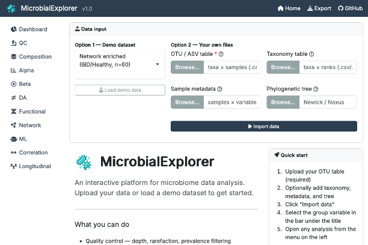
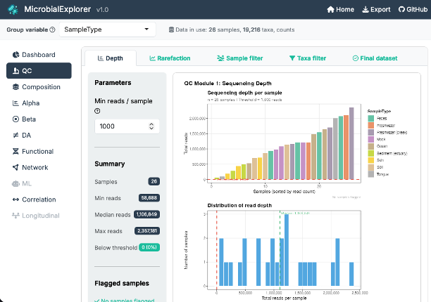
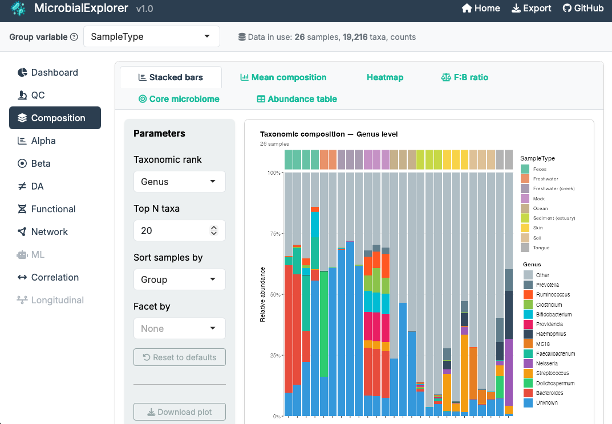
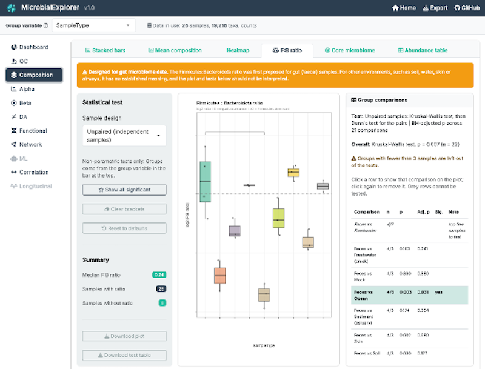

<p align="center">
  
</p>

# MicrobialExplorer

**An interactive R Shiny app for microbiome data analysis, from quality control to differential abundance, without writing code.**

MicrobialExplorer takes a feature table (OTUs or ASVs), with optional taxonomy, sample metadata and a phylogenetic tree, and guides you through a complete analysis in the browser. Every parameter sits next to the plot it affects, so you can change a value, see what happens to your results, and decide which settings suit your data.

> **Status:** version 1.0, under active development. The app currently supports 16S rRNA amplicon data. Support for shotgun metagenomics, virome and longitudinal data is planned (see [Roadmap](#roadmap)).

---

## Screenshots

| Home and data input | Quality control |
|---|---|
|  |  |

| Composition | F:B ratio with group comparisons |
|---|---|
|  |  |

---

## Why MicrobialExplorer

- **You stay in control.** Nothing is filtered or removed until you click *Apply*. Thresholds are yours to set, and each one can be reset to its default.
- **See the effect of every decision.** Controls are on the same screen as the plot, so the consequence of a change is visible immediately.
- **Guidance built in.** Every tab has a "How to read this tab" box explaining what the plot shows, what typical values look like, and how the choice affects the rest of the analysis.
- **Statistics stated clearly.** Tests are named on the plot and in the tables, with adjusted p-values and sample sizes shown.
- **No coding required.** Load a demo dataset or your own files and start exploring.

---

## What you can do

| Module | What it does | Status |
|---|---|---|
| **Dashboard** | Overview of samples, taxa, data type and which modules are available for your data | Available |
| **QC** | Sequencing depth, rarefaction curves, sample filter, taxa filter (prevalence and abundance), final dataset summary | Available |
| **Composition** | Stacked bars at any taxonomic rank, mean composition with error bars, clustered heatmap, Firmicutes:Bacteroidota ratio with non-parametric group comparisons, core microbiome, abundance tables | Available |
| **Alpha diversity** | Diversity metrics by group with statistical tests, rarefaction, gradient plots, results table | Available |
| **Beta diversity** | Ordination, PERMANOVA, dispersion, distance heatmap, environmental fitting | Available |
| **Differential abundance** | DESeq2 and ALDEx2 consensus (ANCOM-BC when installed), volcano plot, effect sizes, heatmap, results table | Available |
| **Functional** | Visualisation of PICRUSt2 pathway predictions | Available |
| **Network** | Co-occurrence networks and hub taxa | In development |
| **Correlation** | Taxa to metadata and taxa to taxa correlations | In development |
| **ML classification** | Random Forest and LASSO with ROC curves | In development |
| **Longitudinal** | Trajectories and stability over time | In development |
| **Export** | Download of results and reports | In development |

Plots can be downloaded as PDF and tables as CSV from each tab.

---

## Installation

MicrobialExplorer runs locally in R (version 4.3 or later recommended).

**1. Get the code**

```bash
git clone https://github.com/agudeloromero/MicrobialExplorer.git
```

**2. Install the R packages**

```r
# CRAN packages
install.packages(c(
  "shiny", "shinyjs", "bslib", "DT", "shinycssloaders",
  "ape", "dplyr", "tidyr", "tibble", "stringr", "forcats",
  "ggplot2", "ggrepel", "ggpubr", "ggdendro", "ggraph", "RColorBrewer",
  "patchwork", "scales", "vegan", "rstatix", "igraph", "tidygraph",
  "Hmisc", "zoo", "caret", "randomForest", "glmnet", "pROC", "e1071",
  "lme4", "lmerTest"
))

# Bioconductor packages
if (!requireNamespace("BiocManager", quietly = TRUE)) install.packages("BiocManager")
BiocManager::install(c("phyloseq", "microbiome", "DESeq2", "ALDEx2", "decontam"))
```

Optional packages add features when they are installed:

| Package | Adds |
|---|---|
| `picante` | Faith's phylogenetic diversity |
| `ANCOMBC` | ANCOM-BC in differential abundance |
| `SpiecEasi` | SPIEC-EASI networks |

---

## Running the app

From R or RStudio, with the working directory set to the project folder:

```r
shiny::runApp("app")
```

The app opens in your browser. Then:

1. On the **Home** page, load a demo dataset or upload your own files and click *Import data*.
2. Choose the **Group variable** in the bar under the title. It defines the groups compared in every module.
3. Open **QC** from the menu on the left, set your filters and click *Apply*.
4. Continue through the analysis modules in the menu.

---

## Input files

| File | Required | Format |
|---|---|---|
| OTU / ASV table | Yes | CSV or TSV. Rows are taxa, columns are samples, first column holds the taxon IDs |
| Taxonomy table | No | CSV or TSV. Rows are taxa (matching the OTU table), columns are ranks (Kingdom to Species) |
| Sample metadata | No | CSV or TSV. Rows are samples (matching the OTU table columns), columns are variables |
| Phylogenetic tree | No | Newick or Nexus |

Without a taxonomy table the Composition module is unavailable; without a tree, Faith's PD is skipped. The Dashboard shows which modules are available for the data you loaded.

**Coming from a Nextflow 16S pipeline?** See [docs/reformat_nextflow_to_microbialexplorer.md](docs/reformat_nextflow_to_microbialexplorer.md) and the helper script [docs/reformat_nextflow.R](docs/reformat_nextflow.R).

**Functional predictions:** see [docs/picrust2_guide.md](docs/picrust2_guide.md).

---

## Demo datasets

| Dataset | Description | Samples |
|---|---|---|
| GlobalPatterns | Body sites and environmental samples (phyloseq) | 26 |
| Enterotype | Human gut microbiome (phyloseq) | 280 |
| Soilrep | Soil warming experiment (phyloseq) | 56 |
| Network enriched | Simulated IBD and healthy samples, included in `data/simulated/` | 60 |

---

## Repository structure

```
MicrobialExplorer/
├── app/
│   ├── global.R        Packages, constants, feature detection
│   ├── ui.R            Page layout: banner, group variable bar, analysis menu
│   ├── server.R        Data flow between modules
│   ├── modules/        One file per app module (upload, QC, composition, ...)
│   └── www/            Stylesheet and logo
├── R/                  Analysis functions used by the app (can also be run as scripts)
├── config/             Pipeline configuration
├── data/simulated/     Simulated demo dataset
├── docs/               Guides and design notes
└── tests/              Test suite for the analysis functions
```

---

## Tests

From the project folder:

```bash
Rscript tests/test_all_modules.R
```

---

## Roadmap

- Shotgun metagenomics input
- Virome analysis
- Longitudinal analysis
- Network, correlation and machine-learning modules
- Parameter record and downloadable report for each run
- Side-by-side comparison of runs with different parameters

---

## Citation

If you use MicrobialExplorer in your work, please cite this repository:

> Agudelo-Romero P. MicrobialExplorer: an interactive Shiny app for microbiome analysis. https://github.com/agudeloromero/MicrobialExplorer

---

## Contact and contributions

Questions, bug reports and suggestions are welcome through [GitHub Issues](https://github.com/agudeloromero/MicrobialExplorer/issues).
